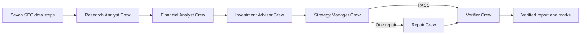

# Week 3 agent team

This folder records the Week 3 reading notes and the CrewAI implementation for the equity desk.

## Framework choice

The application uses CrewAI 1.15.34 with a typed `Flow` for the fixed process and `Process.sequential` inside each role crew. The Flow owns the order, run state, manager decision, one repair route, report compilation, and final verifier. Code selects the next node; a model does not select it. A role can run once, plus one repair call if the Strategy Manager requests it. Current CrewAI requires Python below 3.14, so use Python 3.13.

## Install and run

From the repository root:

```sh
python3 -m pip install uv
uv python install 3.13
uv venv --python 3.13 .venv-crewai
uv pip install --python .venv-crewai/bin/python -r requirements.txt
```

Run a ticker and its peers with a price:

```sh
.venv-crewai/bin/python week03_crewai_flow.py COST --peers WMT,TGT,BJ --price 999.99
```

Verify only a saved run. This does not repeat the data steps or analyst roles:

```sh
.venv-crewai/bin/python week03_crewai_flow.py --verify-only runs/COST_YYYYMMDD_HHMMSS
```

The `.env` file must contain `SEC_USER_AGENT` and your Purdue key as `API_KEY` (the existing `PURDUE_GENAI_API_KEY` name also works). You can set `GENAI_MODEL`; otherwise the program lists the available models and selects one. `GENAI_API_BASE` can set Purdue's OpenAI-compatible endpoint. Never commit `.env`.

## Flow and process



Flow decorators control the end-to-end order and repair branch. Each role runs with its own JSON input envelope in an isolated Crew whose task process is `Process.sequential`. Each role receives only its assigned context. The Verifier runs every time. It receives the compiled report with the Investment Advisor thesis omitted, cited line excerpts from the saved filing texts, and the saved facts. The full filing texts remain in the run folder. Code checks XBRL values, tags, periods, filing lines, and ratio arithmetic. The model checks whether the cited filing supports the number, period, and definition. Each Flow node saves its input and output in the run folder. Cited excerpts keep the request within the model's context limit.

## Lab 04 evidence

- [Completion status and remaining partner/student actions](Lab04_completion.md)
- [Partner verification worksheet](Lab04_partner_check.md)
- Clean COST run: `../runs/COST_20261103_131635/verified_report.md`
- Seeded $1 EPS error: `../runs/COST_20261103_140000_seed_eps/verified_report.md`
- Seeded revenue-growth error: `../runs/COST_20261103_140001_seed_growth/verified_report.md`

The ASD-STE100-style reconstructed request is in [reconstructed-week-03-crewai-flow.md](../prompts/reconstructed-week-03-crewai-flow.md).

## Persona work

The course says students must write the three analyst personas in their own words. The `roles/` files preserve the Lab 03 role boundaries as a starting contract. Replace their text with your own persona writing for Lab 05; this project does not claim that AI wrote your personal personas.

## Readings

See [readings.md](readings.md). The repository stores citations and short original notes, not copies of copyrighted articles or publisher PDFs.
