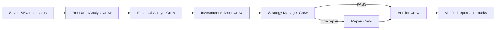

# Week 3 agent team

This folder records the Week 3 reading notes and the CrewAI implementation for the equity desk.

## Framework choice

The application uses CrewAI 1.15.34 with a typed `Flow` for the fixed process and `Process.sequential` inside each role crew. The Flow owns the order, run state, manager decision, one repair route, report compilation, and final verifier. Code selects the next node; a model does not select it. A role can run once, plus one repair call if the Strategy Manager requests it. Current CrewAI requires Python below 3.14, so use Python 3.13.

## Install and run

From the repository root:

```sh
python3 -m pip install uv
uv python install 3.13
uv venv --python 3.13 .venv-crewai
uv pip install --python .venv-crewai/bin/python -r requirements.txt
```

Run a ticker and its peers with a price:

```sh
.venv-crewai/bin/python week03_crewai_flow.py COST --peers WMT,TGT,BJ --price 999.99
```

Start the local browser page:

```sh
.venv-crewai/bin/python -m streamlit run app.py
```

The page streams the node names and shows the saved verified report at the end.

Verify only a saved run. This does not repeat the data steps or analyst roles:

```sh
.venv-crewai/bin/python week03_crewai_flow.py --verify-only runs/COST_YYYYMMDD_HHMMSS
```

The `.env` file must contain `SEC_USER_AGENT` and your Purdue key as `API_KEY` (the existing `PURDUE_GENAI_API_KEY` name also works). You can set `GENAI_MODEL`; otherwise the program lists the available models and selects one. `GENAI_API_BASE` can set Purdue's OpenAI-compatible endpoint. Never commit `.env`.

## Flow and process



Flow decorators control the end-to-end order and repair branch. Each role runs with its own JSON input envelope in an isolated Crew whose task process is `Process.sequential`. Each role receives only its assigned context. The Verifier runs every time. It receives the compiled report with the Investment Advisor thesis omitted, cited line excerpts from the saved filing texts, and the saved facts. The full filing texts remain in the run folder. Code checks XBRL values, tags, periods, filing lines, and ratio arithmetic. The model checks whether the cited filing supports the number, period, and definition. Each Flow node saves its input and output in the run folder. Cited excerpts keep the request within the model's context limit.

## Lab 04 evidence

- [Completion status and remaining partner/student actions](Lab04_completion.md)
- [Partner verification worksheet](Lab04_partner_check.md)
- [Student-authored analyst personas](personas.md)
- Clean COST run with all three sourced insight lines, one permitted repair, and 27/27 verifier marks: `../runs/COST_20261104_151441/verified_report.md`
- Seeded $1 EPS error: `../runs/COST_20261103_140000_seed_eps/verified_report.md`
- Seeded revenue-growth error: `../runs/COST_20261103_140001_seed_growth/verified_report.md`
- Invented unsupported number: `../runs/COST_20261103_185432_seed_invented/verified_report.md` (the claim is marked unsupported)
- Automated tests: `.venv-crewai/bin/python -m unittest tests/test_week03_verifier.py` (20 tests pass)

## Lab 05 evidence

- [Lab 05 completion record and remaining student/partner work](Lab05_completion.md)
- [Blank partner review worksheet](Lab05_partner_check.md)
- [COST run with WMT, TGT, BJ and the logged $992.13 close: 30/30 verifier marks](../runs/COST_20261105_180611/verified_report.md)
- [Final partner-selected UBER run with AMD, YUM, DUOL, PLTR: Manager PASS and 32/32 verifier marks](../runs/UBER_20261108_202611/verified_report.md)
- The run folder contains SEC filing texts, facts, peer facts, every node's inputs and outputs, claims, code checks, final verifier marks, and the saved report.
- Start the local browser interface with `.venv-crewai/bin/python -m streamlit run app.py`. The app accepts a ticker, optional peers and price, displays node progress, and presents the verified report when the run ends. `AppTest` passed.
- The current verifier adds individual marks for all three insight lines, resolves citations to peer filings, and checks reported-unit conversions against nearby statement scale labels. The offline suite has 33 passing tests.
- The final UBER run saved filings, facts, all Flow node inputs and outputs, and final marks. The Strategy Manager passed without a repair, and the Verifier marked 32/32 claims correct. The partner review remains blank for the partner to complete.
- Shachi confirms that she completed her own ASD-STE100 rewrite of the Lab 05 prompt and the separate-chat gap-list activity. The saved [AI-assisted draft](../prompts/lab-05-asd-ste100-draft.md) remains reference material; her final wording is not saved in this workspace.

The ASD-STE100-style reconstructed request is in [reconstructed-week-03-crewai-flow.md](../prompts/reconstructed-week-03-crewai-flow.md).

## Persona work

The student supplied the persona text in `personas.md`; the three analyst nodes load those persona sections together with their separate execution contracts in `roles/`. Each analyst output ends with one sourced `Insight:` line. The Strategy Manager checks the line and can send its part back once. The code checks for exactly one line and a filing plus line or tag citation; the Manager model checks whether the insight adds a filing-supported point beyond the earnings-release opening.

## Readings

See [readings.md](readings.md). The repository stores citations and short original notes, not copies of copyrighted articles or publisher PDFs.
