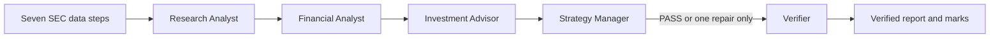

# Week 3 agent team

This folder records the Week 3 reading notes and the fixed agent-team design for this desk.

## Framework choice

This project uses the OpenAI Agents SDK. The project interpreter is Python 3.14.7. The current CrewAI release requires Python below 3.14, so it cannot run in this environment. The OpenAI Agents SDK lists Python 3.10 and newer and supports an OpenAI-compatible chat-completions endpoint, which works with the existing Purdue GenAI Studio configuration.

## Install and run

From the repository root, install with:

```sh
python3 -m pip install -r requirements.txt
```

Run a ticker and its peers with a price:

```sh
python3 week03_agent_team.py COST --peers WMT,TGT,BJ --price 999.99
```

Replace `999.99` with the close used in your Lab 03 run. To verify a saved run without rerunning its data steps or analyst roles:

```sh
python3 week03_agent_team.py --verify-only runs/COST_YYYYMMDD_HHMMSS
```

The `.env` file must contain `SEC_USER_AGENT` and your Purdue key as `API_KEY` (the existing `PURDUE_GENAI_API_KEY` name also works). You can set `GENAI_MODEL`; otherwise the program lists the available models and selects one. `GENAI_API_BASE` can set Purdue's OpenAI-compatible endpoint. Never commit `.env`.

## Fixed graph



Python selects the nodes, order, inputs, retry limit, saved files, and stopping point. Each model role writes analysis inside its fixed node. The Verifier always runs after the Manager. No flag bypasses it.

## Persona work

The course says students must write the three analyst personas in their own words. The `roles/` files preserve the Lab 03 role boundaries as a starting contract. Replace their text with your own persona writing for Lab 05; this project does not claim that AI wrote your personal personas.

## Readings

See [readings.md](readings.md). The repository stores citations and short original notes, not copies of copyrighted articles or publisher PDFs.
